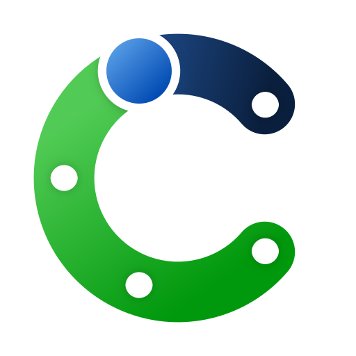
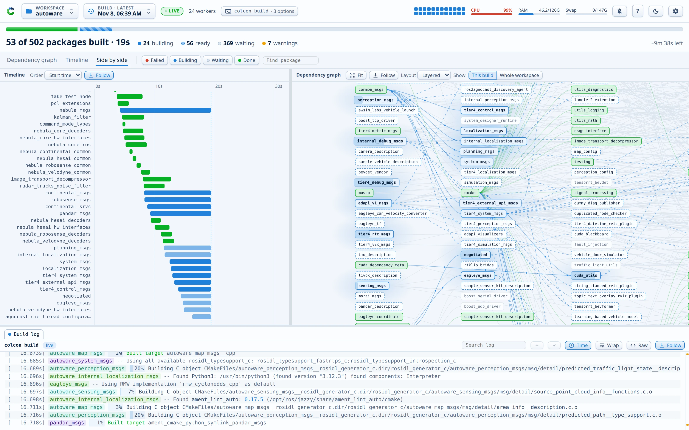

<p align="center">
  <picture>
    <source media="(prefers-color-scheme: dark)" srcset="https://raw.githubusercontent.com/autowarefoundation/colcon-dashboard/main/docs/assets/logo-dark.svg">
    
  </picture>
</p>

<h1 align="center">Colcon Dashboard</h1>

<p align="center"><b>See your colcon build.</b><br>A live dashboard for <code>colcon build</code>: the dependency graph, a timeline, one log per package, and the load on your machine.</p>

<p align="center">
  <a href="https://autowarefoundation.github.io/colcon-dashboard/">Documentation</a> ·
  <a href="https://autowarefoundation.github.io/colcon-dashboard/install/">Install</a> ·
  <a href="https://autowarefoundation.github.io/colcon-dashboard/quick-start/">Quick start</a> ·
  <a href="https://pypi.org/project/colcon-dashboard/">PyPI</a>
</p>

<picture>
  <source media="(prefers-color-scheme: dark)" srcset="https://raw.githubusercontent.com/autowarefoundation/colcon-dashboard/main/docs/assets/screens/hero-dark.webp">
  
</picture>

## Why

A long `colcon build` prints a wall of text. You cannot see what builds now, what waits, which package is slow, or where the first error is. Colcon Dashboard shows all of it on one page, while the build runs.

- **Nothing changes in how you build.** The dashboard reads the logs that colcon already writes into `log/`. Every build shows up: from any terminal, with any options.
- **No dependencies.** The server is plain Python 3.8 or newer, with only the standard library.
- **One address for every workspace.** One server on `localhost:8642` serves all your workspaces, from a small package set to a 500-package Autoware build.

## What you get

- **Dependency graph**: every package, placed by its dependency depth. Packages turn blue while they build and green when they are done. Hover a package to see its whole dependency chain.
- **Timeline**: a Gantt chart of every package. Sort it by duration to find the packages that slow the build.
- **Log panes**: one tab per package, so parallel output never mixes. Errors and warnings stand out, install lines fold, and search stays fast also in a 10 MB log.
- **Failures**: the log of a failed package opens by itself, and a Failures tab collects every error. One click asks [Claude](https://claude.com/claude-code) to find the cause.
- **History**: every build and test run, with its outcome and its time against the previous run.
- **System meters**: a per-core heatmap and the CPU, RAM, and swap meters, because a big build can run out of memory.
- **Desktop app**: install the page as an app with its own window, get desktop notifications, and use the optional tray icon.

## Install

On Ubuntu, install the apt package. It upgrades with your system updates:

```bash
sudo add-apt-repository ppa:xmfcx/colcon-dashboard
sudo apt install python3-colcon-dashboard
colcon-dashboard --start-service
```

On any Linux distribution, use pipx:

```bash
pipx install colcon-dashboard
colcon-dashboard --install-service
```

The service starts the server at every login. Open <http://localhost:8642/>, pick your workspace, and run `colcon build` as usual.

The [documentation](https://autowarefoundation.github.io/colcon-dashboard/) has the full tour, the desktop app, the configuration, and the command line.

## Security

The server binds to `127.0.0.1` by default. It trusts every caller, so expose its port only to a network that you trust. To watch a build on another machine, use an [SSH tunnel](https://autowarefoundation.github.io/colcon-dashboard/remote/).

## License

Apache 2.0
