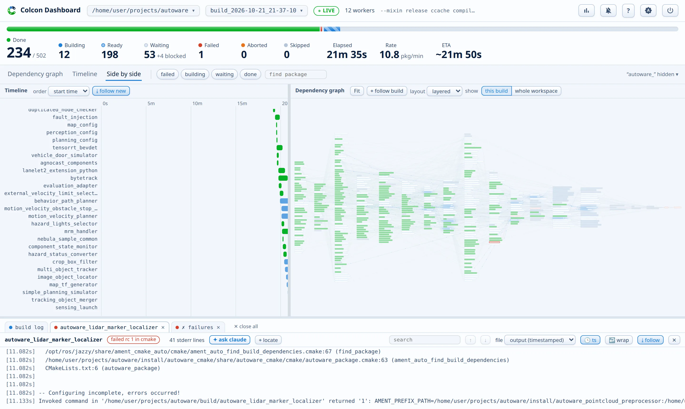

# Colcon Dashboard

A live web dashboard for `colcon build`. It shows how many packages are done, building, ready, waiting, or failed. It draws the dependency graph and colors each node as the build moves through it. Each package gets its own log pane, so logs never mix.

**Documentation: <https://autowarefoundation.github.io/colcon-dashboard/>**



The server uses only the Python standard library, with zero dependencies. It works on any colcon workspace (ROS 2, Autoware, or anything else that colcon builds). It reads the log files that colcon already writes under `log/`, so any build appears, from any terminal, with any options.

## Highlights

- **Dependency graph**: every package, laid out by dependency depth and recolored live as the build moves. The layouts are layered, force, and a 3D wavefront.
- **Timeline**: a Gantt chart of every started package. It makes the parallelism and the long serial chains visible.
- **Log panes**: one tab per package, with search, ANSI colors, timestamps, and editor links. Failed panes open by themselves.
- **AI failure analysis**: one click starts a headless [claude](https://claude.com/claude-code) run on a failed package and streams the investigation live.
- **System pressure**: a per-core heatmap plus CPU, RAM, and swap meters, because a colcon build can exhaust the machine.
- **Build history**: every build and `colcon test` run, with outcomes, durations, and deltas against the previous run.

## Install

On Ubuntu, install the apt package. It upgrades with the usual system updates:

```bash
sudo add-apt-repository ppa:xmfcx/colcon-dashboard
sudo apt install python3-colcon-dashboard
colcon-dashboard --install-service
```

On any distribution, pipx does the same job.

```bash
pipx install colcon-dashboard
colcon-dashboard --install-service

# upgrade later
pipx upgrade colcon-dashboard
```

Plain `pip install colcon-dashboard` also works in a virtual environment with Python 3.8 or newer.

The service starts the server at login. Open <http://127.0.0.1:8642/> and pick your workspace. That is the whole setup. After an upgrade, run `colcon-dashboard --restart-service` to load the new version.

The [install page](https://autowarefoundation.github.io/colcon-dashboard/install/) covers the install from a checkout and the service commands.

## Quick start

Build as you always do, and open the page of your workspace:

```text
$ colcon build
$ colcon-dashboard . --open
already running: http://127.0.0.1:8642/?ws=%2Fhome%2Fuser%2Fws
```

This is the output when the service runs the server. Without the service, the same command starts the server in the terminal, in the foreground, until you press Ctrl+C.

Expose the port only to a network that you trust. The server trusts every caller.

The [documentation](https://autowarefoundation.github.io/colcon-dashboard/) covers the full page tour, the configuration file, the command line, and the HTTP API.
