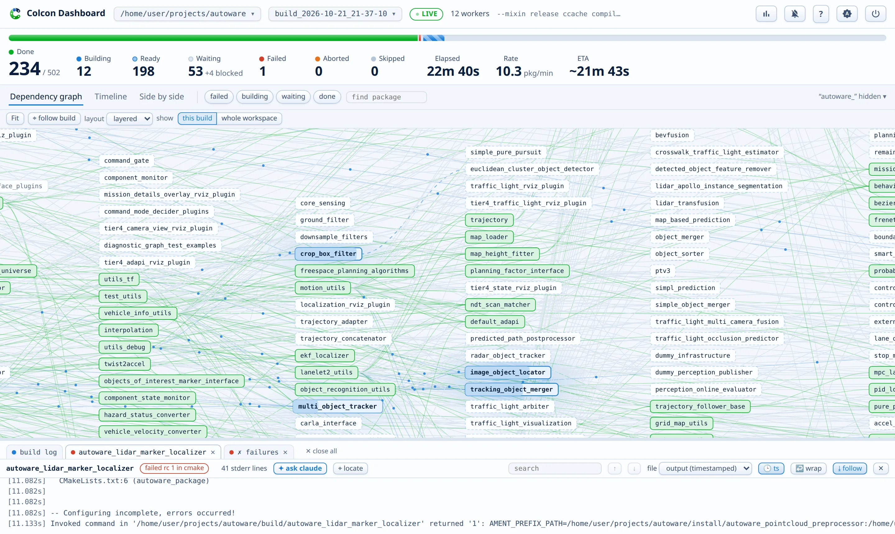

# Dependency graph

Every package in the build, laid out left to right by dependency depth. An edge points from a dependency to the package that needs it.

## Node states

Node states combine color, border, and motion:

- **Done**: a green wash.
- **Building**: a blue box that slowly breathes, each node in its own rhythm. The box fills left to right with a deeper blue as make reports `[ 42%]` progress. The label stays legible on top. A faint halo glows behind the node on the backmost layer, so the active zone shows even from far out.
- **Ready**: a dashed blue border. All dependencies are done, and the package starts as soon as a worker becomes free.
- **Next up**: a slow pulse. This waiting package starts when the packages that build now finish, because no deeper dependency blocks it.
- **Waiting**: quiet gray. **Skipped**: gray with a struck label.
- **Failed**: solid red. Everything downstream of a failure turns red-dashed with red edges. This blast radius looks different from the packages that the stop only abandoned, which stay gray.
- **Aborted**: orange. The package was building when the build stopped.

## Edges

Edges take color from their endpoints:

- Light green between two done packages: finished lineage.
- Solid blue into a building package, with droplets that flow along the edge at constant speed: the package consumes its finished dependencies.
- Dashed blue marching into a next-up package: what it waits for.
- Red along the failure cascade.

## Interaction

- Hover a node to see its state, phase, time, stderr count, and path. The hover also lights its full dependency chain while the rest dims. When the previous build has a duration for the package, the tooltip compares them, and marks a clear regression.
- Click a node to select it, and to open its log. A selection keeps the dependency chain in focus after the mouse leaves. Ctrl+click or Shift+click adds a node to the selection, or takes it out again, and the focus then shows all the selected chains. To clear the selection, click empty space or press Esc.
- Click a node to open its log pane.
- The **find package** box highlights matching packages while the rest fades, in every layout and in the timeline. ++enter++ and ++shift+enter++ jump through the matches. The ++slash++ key jumps to the box.
- The **state chips** (failed, building, waiting, done) filter the same way by state instead of by name, and combine with the find box. One click on **failed** shows the whole blast radius of a broken build.
- Double-click a log tab in the dock to center the view on that package.
- Drag to pan, scroll to zoom. **Fit** frames the whole graph.
- When you zoom out so far that a label would be a mere smudge (under 1.5 pixels high), the labels hide and each node becomes a plain colored box. Until then, the labels stay, even when they are small.
- **Follow** keeps the camera on the packages that build now, so the action stays framed as the build moves. If you pan or zoom by hand, the camera is yours again.
- The **show** switch picks what the graph draws: only the packages of this build, or the whole workspace.
- When most package names share a prefix such as `autoware_`, the labels hide it. Tooltips keep the full name. To pick other prefixes, or to show the full names, open the settings (the gear button) and use **Package names**. The section suggests the common prefixes of the workspace, and you can hide more than one. The graph, the timeline, the log tabs, and the failures use the short names. The pane headers and the tooltips show the full names. The page saves the choice per workspace in this browser.

## Layout modes

The **layout** menu picks one of three modes, and the choice persists:

- `layered`: the static left-to-right layout described above.
- `force`: a live spring simulation with the same left-to-right anchoring. Drag nodes to rearrange. The simulation cools and stops by itself.
- `3d`: the build as a wavefront. Building packages share one central plane, finished discs stack to its left, and waiting discs queue to the right by dependency depth. Packages glide through the blue plane as the build advances. Left-drag orbits. Shift-drag, right-drag, or middle-drag pans. The wheel zooms. The camera rotates by itself until the first grab.

Fit and Follow drive the camera in every mode. In the force and 3D modes, the camera keeps the whole graph in view while the nodes spread out. The first pan, zoom, or drag stops this, and Fit starts it again. In the force and 3D modes, a **Spread** slider in the corner scales how far the simulation spreads the nodes.
