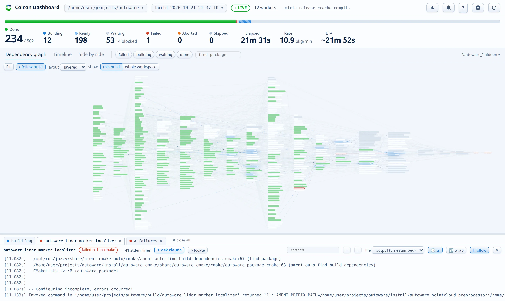

# The dashboard

## Header

The header shows two switchers, a LIVE / COMPLETE / FAILED / STOPPED badge, and the parallel worker count. The Workspace switcher shows the name of the workspace folder, and a click opens the workspace picker as a dropdown under it. The Build switcher shows when the build started, and a click opens the build picker. Its caption says "latest" when the page follows the newest build, and "pinned" when the page shows an earlier one. Hover over a switcher to see the full workspace path or the build id. The bell button turns on desktop notifications: the build finished, the build failed, or the first package failed. A second click adds a quiet chime. The ? button (or the ++question++ key) opens the keyboard and mouse reference. The gear button opens the settings in a panel at the right edge, which stays open while you work with the dashboard: the theme, the notifications, the log pane defaults, and a page layout reset. The settings also edit the scan roots and show the server configuration. They turn the start at login and the [tray icon](../desktop-app.md#the-tray-icon) on or off, restart the server, and stop it after a confirmation. When the server stops answering, the whole top panel turns red.

The browser tab mirrors the build even in the background. The title shows `[42%] workspace` while the build runs, and then ✓ or ✗. The favicon changes color with it.

## Workspace picker

If you open the page without a workspace, the picker fills the page as a start page.

The workspace picker has three sections: "Starred", "Recent", and "Found on disk". Each row shows the workspace name, its parent directory, and the time since the last build. A dot shows the result of the last build: green for passed, red for failed, orange for aborted, and gray when the result is not known yet. A workspace that builds now shows a progress bar. Hover a row to see the build count and the log size. A star moves a workspace to "Starred", and a sort menu reorders each section by last build, build count, or log size.

The box at the top filters the list as you type. The arrow keys move through the rows, and Enter opens the highlighted row. If you paste a path and press Enter, the page opens that path. Escape clears the box, and a second Escape closes the picker.

The picker scans for colcon workspaces when it opens for the first time. The scan searches your home directory and the scan roots (see [Configuration](../configuration.md#extra-scan-roots)). If three or more found workspaces share a parent directory, the picker folds them into one row. Click the row to unfold it. "rescan" in the section header runs the scan again.

If `check_updates = true` is set in the [config file](../configuration.md), a dismissible line appears here when PyPI has a newer release. The server makes no other network request, ever.

## Build picker

The build picker lists every build and `colcon test` run of the workspace, with its log size and its outcome. The outcome is a passed, failed, or aborted chip, with the done, failed, aborted, and skipped package counts. Each finished run also shows its total duration, and the delta against the previous run of the same kind. A slower run shows `+3:12` in red. A faster run shows `−1:04` in green.

Open a run and the whole dashboard shows it, with the `build` query parameter in the address. The 🗑 buttons delete the logs of one run. A prune action keeps the last three runs of each kind (build and test). The server refuses to delete a run that still writes its logs. The `auto_prune_keep` key does the same pruning automatically each time the server sees a finished build, for every workspace that it watches.

## System strip

The right side is the system strip. A colcon build can exhaust the machine, so pressure stays visible at all times:

- A per-core heatmap, one cell per core. Cell color runs from the idle gray to full blue at 100% use. Hover a cell for the exact number.
- CPU, RAM, and swap meters. A fill turns amber under pressure (CPU 85%, RAM 75%, swap 30%) and red near the limit (96%, 90%, 70%). At red the label also turns red and bold.
- Hover the CPU meter for the load average. Hover the RAM meter for the exact percentage.
- In a narrow window the strip folds behind a chart button and drops down on demand.

## Progress strip

The meter fills as the build advances: green for done, animated blue stripes for building, red for failed, orange for aborted.

While a build runs, the tiles count each state: done out of the total, building, ready, waiting (plus a blocked count after a failure), failed, aborted, and skipped. Elapsed time, the rate in packages per minute, and an ETA sit at the end. The ETA is an estimate: the longest remaining dependency chain, or the remaining work spread over the workers, whichever is larger. The duration of each package comes from the previous build.

After the build ends, one summary line replaces the tiles, for example "502 packages built in 0:44". The line also gives the failed, aborted, skipped, and unbuilt counts. If packages printed compiler or CMake warnings, the line shows the warning count. Hover over the count to see the packages. Click it to open a package log at its first warning.

## Theme

The page starts in the light theme. The theme button (or the settings) switches between light and dark, and the page keeps your choice. Every view recolors instantly, including the 3D canvas.
