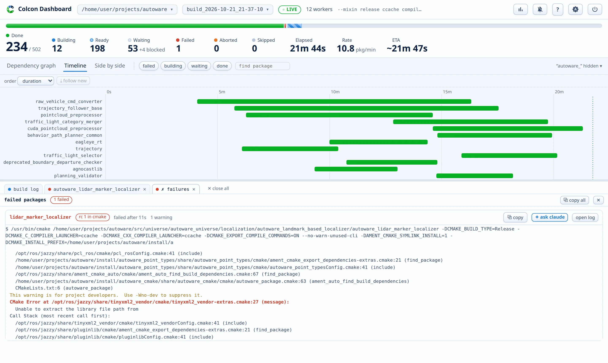

# Log panes

The dock opens with a pinned **build log** tab: the whole build, as a terminal shows it, with `Starting >>>` and `Finished <<<` lines between the output of every package. Click any package in the graph or the timeline to open its own tab next to it. Each tab has its own scrollback, so logs never interleave.

- A pane follows new output until you scroll up. The **Follow** button re-engages.
- Panes open at the tail for an instant start. **Load all** fetches the whole history in one click.
- Every line carries a timestamp: build-relative in the build log, job-relative in package panes. The **Time** button hides them.
- The **Wrap** button soft-wraps long lines. The choice sticks for future panes. AI panes start wrapped, because prose reads badly on one line.
- The **search** box filters as you type, and matching lines highlight. ++enter++ and ++shift+enter++ step through the matches. The search stays live while the log streams.
- A selector switches a package pane between the timestamped output, `stdout+stderr`, `stderr`, `stdout`, and the command log.
- If a finished package has no timestamped output, the pane switches to `stdout+stderr` and says so. An empty pane always shows a note that tells why it is empty.
- The panes show ANSI colors as a terminal does: the 16 classic colors, 256-color, and truecolor, with palettes tuned per theme. Lines without ANSI colors get the log highlighting below.
- If a package fails, its pane opens by itself and a toast points to it. A page that opens on an already failed build also opens the panes of the failed packages, earliest failure first.
- A **Failures** tab appears with the first failure, and it aggregates every failed package. It shows the last stderr lines of each, in failure order, with a jump link, an **Open log** button, and the **Ask Claude** button. When a failed build ends, this pane comes to the front.
- The **Path** button in a package pane copies the absolute source path of the package.
- If `editor_url` is [set](../configuration.md#editor-links), each `file:line` position in the logs gets a ↗ link that opens your editor at that line.
- The ✕ on a tab closes its pane. **Close all** at the end of the tab strip closes every tab except the build log.
- Drag the bar above the dock to resize it.

## Log highlighting

colcon writes its logs without colors, so the panes color the recurring parts of the output themselves:

- Rows alternate in a faint stripe, and the row under the mouse lights up. A wrapped line indents past its timestamp, so it reads as one line.
- Errors get a red bar at the left edge and a red tint, warnings an amber one, and notes a blue one. This covers GCC, Clang, and NVCC diagnostics, CMake warning and error blocks, and failed commands.
- A strip beside the scrollbar marks where the errors (red) and warnings (amber) sit. Click a mark to jump to its line.
- In the build log, each package name has its own color, so the interleaved output of parallel jobs separates. Click a package name to open its log. `Starting >>>` and `Finished <<<` lines stand out, and a long package duration turns orange (over a minute) or red (over five minutes).
- The lines of the install step (`-- Up-to-date:`, `-- Installing:`, `-- Symlinking:`, and their kin) fold into one line with the count, for example "312 install lines". They are often more than half of a build log. In the build log, all install lines of one package go into one group, also when other packages print in between, and the group line shows the package name. Click the group line to open it. A search match inside a folded group opens it.
- CMake progress lines show their percent as a small bar. `Built target` lines are green, and `Linking` lines are blue.
- A compiler diagnostic shows the file position underlined, the severity in bold, quoted code on a tint, and the warning flag (`[-Wdeprecated-declarations]`) dimmed. The code excerpt below it dims the line numbers and colors the caret like the severity.
- The long `Invoking command` lines in package panes fold the environment variables into one chip, for example "4 environment variables". Click the chip to show them. The command and its flags stay visible.
- Directories in paths are dimmed, so the file names stand out.

To see the exact log text, click **Raw** in the pane toolbar. Raw shows every line as colcon wrote it: no highlighting, no folded groups, and no collapsed environment. Terminal colors still show, and the marks beside the scrollbar still point to the errors and warnings. The choice sticks for future panes, and **Raw output** in the settings switches it for every open pane.

The address bar mirrors the open pane and the picked view (`#pkg=...&view=...`), so a copied link opens the same package pane for a colleague. The `ws` and `build` query parameters already pin the workspace and the build.
