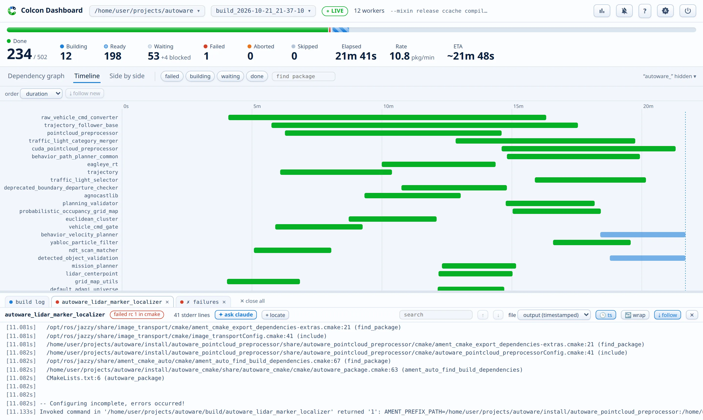

# Timeline

A Gantt chart of every started package, with a dashed now line. The time axis stays at the top while you scroll the rows. A long package name ends in "…", and its tooltip shows the full name. Drag the right edge of the name column to resize it. The width persists. A double-click on the edge fits the column to the names again. Bar colors match the graph states.

The **order** menu sorts the rows: by start time, by duration with the longest build first, by end time, or by status with failures on top. The choice persists.

The chart makes the parallelism and the long serial chains visible. It auto-scrolls to the newest bars as they start. Scroll up to release, or use the **Follow** toggle. Drag anywhere to pan, like the graph. A reload of the page keeps the place: the same package at the top, or the end when the chart followed it. A new build starts at its end.

Click a bar or a package name and its log pane opens while the graph flies to that package. From the pure timeline, this click switches to the side-by-side view, so the graph comes in without losing the timeline.

**Side by side** shows the graph and the timeline together, over a drag bar. It is the default view, and the split ratio and the view choice persist.
